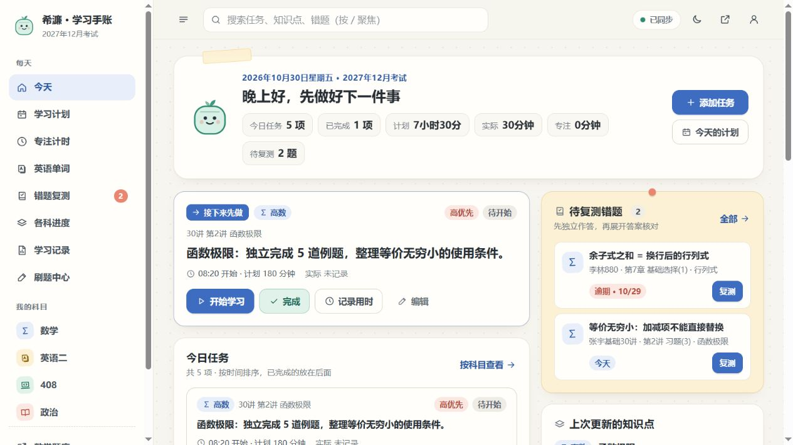
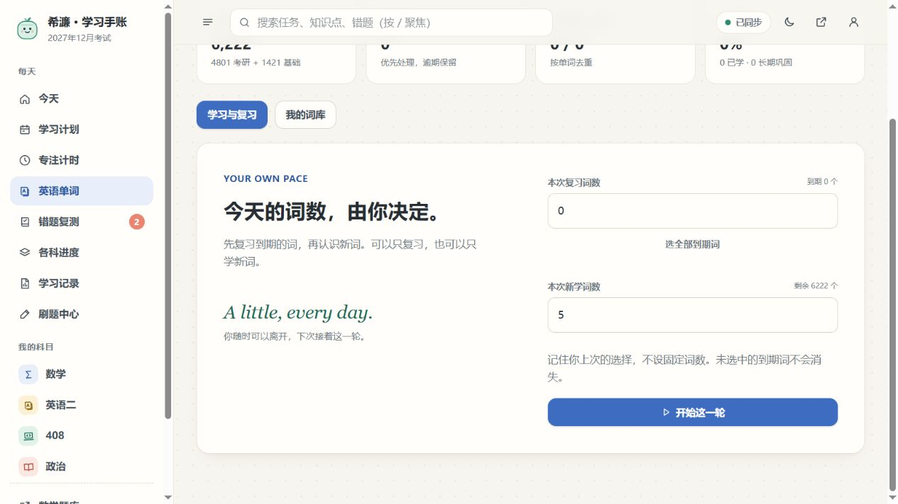
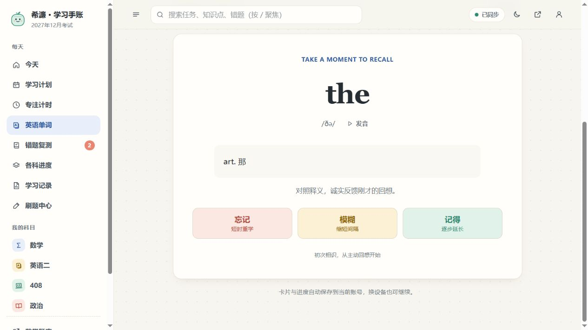

# RecallKit · Open-source study review

**[Try RecallKit online](https://tmjiljl.github.io/my_study/)** · [Source code](./recallkit/) · [Report a bug](https://github.com/Tmjiljl/my_study/issues/new?template=bug_report.md) · [Suggest a feature](https://github.com/Tmjiljl/my_study/issues/new?template=feature_request.md)

RecallKit is a free, local-first review card app for students and lifelong learners. No account, database, or backend is required.

## Features / 功能

- Create knowledge cards grouped by subject / 按学科创建知识卡片
- Review due cards with transparent spaced intervals / 间隔复习
- Track recent review activity / 学习概览
- Search and filter cards / 搜索筛选
- Export and import JSON backups / JSON 备份与恢复
- Responsive design; browser-local storage by default / 移动端适配，本地存储

## Get involved / 参与开源

We welcome **genuine** bug reports, thoughtful feature proposals, accessibility feedback and pull requests.

- [Bug report](https://github.com/Tmjiljl/my_study/issues/new?template=bug_report.md) · [功能建议](https://github.com/Tmjiljl/my_study/issues/new?template=feature_request.md)
- [Open issues](https://github.com/Tmjiljl/my_study/issues) · [Pull requests](https://github.com/Tmjiljl/my_study/pulls)
- [Contributing guide](./recallkit/CONTRIBUTING.md)
- [Security and privacy](./recallkit/SECURITY.md)
- [Roadmap and limitations](./recallkit/README.md#roadmap)

Before opening an issue, search for duplicates. Please remove all personal study information from screenshots, backups and bug reports.

## Run locally

```bash
cd recallkit
python3 -m http.server 8080
```

Open http://localhost:8080. To run unit tests (Node.js 20+): `npm --prefix recallkit test` from the repository root.

## Project status

RecallKit v0.1.0 is an early MVP. It does **not** yet offer card editing, user accounts, server sync or an independently verified user base. Data is stored locally in your browser; export backups regularly.

The application under `recallkit/` has its own **MIT license**; see [recallkit/LICENSE](./recallkit/LICENSE). The repository's root [LICENSE](./LICENSE) is separate. Do not assume they cover the same files.

Maintained at [Tmjiljl/my_study](https://github.com/Tmjiljl/my_study). Community feedback and contributions are welcome; maintainers will document real work without manufacturing engagement metrics.

## Study Hub · 考研学习管理系统

This repository also contains a separate Study Hub source bundle. The screenshots below show **Study Hub**, not RecallKit. See [Study Hub documentation](./study-hub/README.md) and [live website](https://xilien-study-hub.glossymesa32.chatgpt.site). All screenshots use synthetic demo data.

## 界面截图（示例数据）

以下截图均取自 2026-10-30 的本地示例环境，使用虚构学习任务和演示账号，不代表真实用户的学习记录或成绩。

### 学习概览

集中查看今日任务、下一项学习内容和到期错题，区分计划用时与实际记录。



### 自选新学与复习词数

分别选择每轮新学词数和复习词数，不固定每日数量；未选中的到期词继续保留。



### 单词回想与记忆反馈

先主动回想，再查看释义；按“忘记、模糊、记得”反馈安排后续间隔复习。


